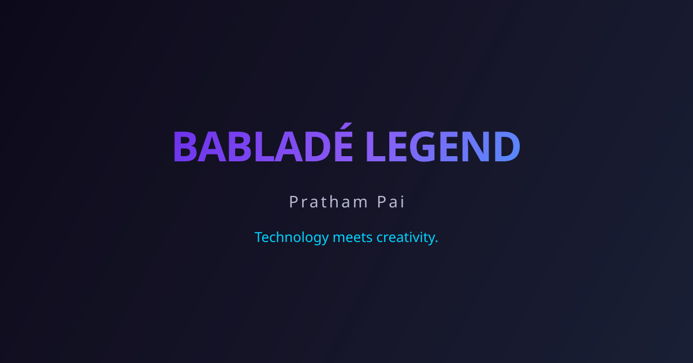

# BABLADÉ LEGEND — Portfolio Website

> **Technology meets creativity.** Personal portfolio of Pratham Pai (Babladé Legend) — Student, Technology Enthusiast, Photographer, Filmmaker, and Creative Coder.



## ✨ Features

### Sections
- **Hero** — Animated entrance with profile avatar, gradient text, and scroll indicator
- **About** — Personal story with interest cards (Photography, Filmmaking, Code, Design, Linux, AI)
- **Skills & Interests** — 6 categories with 30+ detailed skill items (Languages, Frameworks, Tools, Platforms, Creative, Learning)
- **Projects** — Live GitHub API integration showing public repositories with language tags, stars, topics, and links
- **Photography** — Masonry grid with 6 photos, hover animations, and creative philosophy card
- **Social Presence** — Branded social cards for GitHub, LinkedIn, YouTube, Instagram, Duolingo
- **Contact** — Quote, social links, and CTA button

### Design & Animation
- **Color Palette**: Electric blue (`#00d4ff`), Deep violet (`#4a00e0`), Soft purple (`#8b5cf6`), Pure white, Subtle charcoal
- **Typography**: Space Grotesk (display), DM Sans (body), JetBrains Mono (code)
- **Animations**: Scroll-triggered reveals, staggered entrances, parallax backgrounds, mouse parallax, reduced motion support
- **Background**: Canvas-based particle/grid animation in Hero section
- **Responsive**: Mobile-first, breakpoints at 480px, 768px, 1024px, 1440px

### Technical
- **Vite + React 19** with CSS custom properties design system
- **IntersectionObserver API** for performant scroll animations
- **Custom hooks**: `useIntersectionObserver`, `useReducedMotion`, `useScrollPosition`, `useGitHubRepos`
- **GitHub REST API v3** for live repository data (public repos only)
- **Semantic HTML5** with full ARIA accessibility
- **Zero CSS framework** — all custom CSS with design tokens

## 🚀 Quick Start

### Prerequisites
- Node.js 18+
- npm 9+

### Installation
```bash
# Clone and install
git clone https://github.com/prathamppai/bablade-legend.git
cd bablade-legend
npm install

# Development server
npm run dev

# Production build
npm run build

# Preview production build
npm run preview

# Lint
npm run lint
```

### Environment Variables
Create `.env.local` for GitHub API (optional — increases rate limit from 60/hr to 5000/hr):
```env
VITE_GITHUB_TOKEN=ghp_your_personal_access_token
VITE_GITHUB_USERNAME=prathamppai
```

## 📁 Project Structure

```
src/
├── components/
│   ├── ui/                 # Reusable UI primitives
│   │   ├── Button.jsx
│   │   ├── Card.jsx
│   │   ├── Section.jsx
│   │   ├── ScrollReveal.jsx
│   │   └── Parallax.jsx
│   ├── layout/             # Layout components
│   │   ├── Navigation.jsx
│   │   ├── Header.jsx
│   │   └── Footer.jsx
│   ├── hero/               # Hero section
│   ├── about/              # About section
│   ├── skills/             # Skills section
│   ├── projects/           # Projects section (GitHub API)
│   ├── photography/        # Photography gallery
│   ├── social/             # Social links
│   └── contact/            # Contact section
├── hooks/                  # Custom React hooks
│   ├── useIntersectionObserver.js
│   ├── useReducedMotion.js
│   ├── useScrollPosition.js
│   └── useGitHubRepos.js
├── styles/
│   ├── variables.css       # Design tokens (colors, spacing, typography, shadows)
│   └── globals.css         # Global styles, utilities, animations
├── App.jsx                 # Main composition
└── main.jsx                # Entry point

public/
├── bablade.jpg             # Profile photo
├── photo-1.webp ... photo-6.webp/jpg  # Photography images
├── favicon.svg
└── og-image.svg
```

## 🎨 Design System

### Colors (CSS Custom Properties)
```css
:root {
  --color-bg: #0a0a14;
  --color-bg-elevated: #11111f;
  --color-bg-card: #161622;
  --color-primary: #00d4ff;
  --color-primary-violet: #4a00e0;
  --color-accent: #8b5cf6;
  --color-text: #ffffff;
  --color-text-muted: #b8b8d0;
  --color-text-dim: #8a8a9e;
  --border-subtle: rgba(139, 92, 246, 0.15);
  --border-accent: rgba(0, 212, 255, 0.4);
}
```

### Spacing Scale
`--space-xs` (0.25rem) → `--space-4xl` (4rem) — 12 steps

### Typography
- **Display**: Space Grotesk, weights 400–700
- **Body**: DM Sans, weights 400–600
- **Mono**: JetBrains Mono, weights 400–600

## 🔧 Customization

### Update Personal Info
Edit `src/components/hero/HeroContent.jsx`:
```jsx
const HERO_COPY = {
  main: 'BABLADÉ LEGEND',
  name: 'Your Name',
  tagline: 'Your tagline',
  description: 'Your roles',
}
```

### Add/Modify Skills
Edit `src/components/skills/Skills.jsx` — `SKILL_CATEGORIES` array

### Update Social Links
Edit `src/components/layout/Navigation.jsx` and `src/components/social/SocialLinks.jsx` — `SOCIAL_LINKS` array

### Add Photography
Drop images in `public/` and update `photos` array in `src/components/photography/Photography.jsx`

### Update About Section
Edit `src/components/about/About.jsx` — `INTERESTS` array and bio text

## 📦 Deployment

### GitHub Pages (Recommended)
1. Enable GitHub Pages in repo settings (source: GitHub Actions)
2. Push to `main` — workflow deploys automatically
3. Or use `npm run deploy` if you configure `gh-pages` package

### Vercel / Netlify
```bash
# Build command: npm run build
# Output directory: dist
# Install command: npm install
```

### Manual
```bash
npm run build
# Upload dist/ folder to any static host
```

## ♿ Accessibility

- Semantic HTML5 landmarks (`header`, `nav`, `main`, `section`, `footer`)
- ARIA labels on all interactive elements
- Focus-visible styles for keyboard navigation
- `prefers-reduced-motion` respected globally
- Alt text on all images
- Color contrast ratios meet WCAG AA

## 🛠 Scripts

| Command | Description |
|---------|-------------|
| `npm run dev` | Start dev server (port 5173) |
| `npm run build` | Production build to `dist/` |
| `npm run preview` | Preview production build |
| `npm run lint` | ESLint with React hooks rules |
| `npm run format` | Prettier (if configured) |

## 📄 License

MIT License — feel free to use as inspiration for your own portfolio.

## 🙏 Credits

- **Fonts**: Space Grotesk, DM Sans, JetBrains Mono (Google Fonts)
- **Icons**: Custom SVG icons (GitHub, LinkedIn, YouTube, Instagram, Duolingo, etc.)
- **API**: GitHub REST API v3
- **Inspiration**: Apple, Nothing, cyberpunk aesthetics

---

**Built with** ⚡ Vite + React 19 + CSS Variables + IntersectionObserver